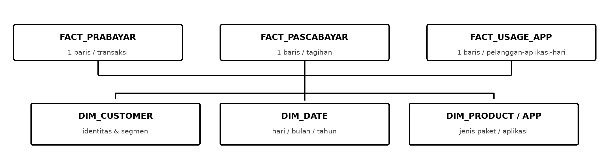

# Telco Data Engineering Pipeline

A small, end-to-end Data Engineering project built with Python and SQLite.

I made this project as part of my Week 4 Data Engineering practice. The idea was to work through a common problem in a telecom company: customer, transaction, billing, and app-usage data often come from different systems, but they need to be brought together before anyone can use them for reporting or machine learning.

Here, I use **synthetic data** to build that flow locally—from generating CSV files to preparing customer features that could later be used for churn prediction.

## How it works


The pipeline follows a few main steps:

1. **Generate sample data** for customers, prepaid transactions, postpaid billing, and app usage.
2. **Ingest the CSV files** into a raw layer in SQLite.
3. **Check data quality**, including duplicates, invalid values, and inconsistent records. Invalid records are logged separately instead of silently entering the reporting tables.
4. **Build a Data Warehouse** using dimension and fact tables.
5. **Prepare customer features**, such as recent usage, top-up activity, and payment behavior.
6. **Record each pipeline run**, along with data-quality results and alerts.

The warehouse design is shown here:



## Tools used

- **Python 3.10+** for data generation, ingestion, and transformation
- **SQLite and SQL** for the raw layer, Data Warehouse, and reporting queries
- **Python `unittest`** for automated tests

Everything runs locally using Python's standard library, so no extra packages are required.

## Running the project

Open a terminal in the repository folder and run:

```bash
python3 run_pipeline.py generate --run-date 2026-10-24
python3 run_pipeline.py run --run-date 2026-10-24
python3 -m unittest discover -s tests -v
```

The commands generate the sample CSV files, run the pipeline, and execute the tests. If your computer uses `python` instead of `python3`, use that command instead.

After running the pipeline, the main outputs are:

- `outputs/telco_dwh.sqlite` — the local Data Warehouse
- `outputs/customer_features.csv` — customer-level features prepared for future ML work
- `outputs/run_report.json` — pipeline results, data-quality checks, and alerts

There are also example outputs in [`outputs/sample/`](outputs/sample/), so you can explore the results without running the project first.

## Results from my local run

I tested the pipeline using **240 synthetic customers** and the fixed date `2026-10-24`.

| What I checked | Result |
|---|---:|
| Input records processed | 12,138 |
| Unique records stored in the raw layer | 12,136 |
| Invalid records quarantined | 4 |
| Customer records in the warehouse | 240 |
| Prepaid transaction records | 1,105 |
| Postpaid billing records | 84 |
| Daily app-usage records | 9,116 |
| Customer feature rows | 240 |
| Automated tests passed | 6/6 |

I also ran the pipeline twice with the same input. On the second run, `inserted_raw` was **0**, and the warehouse row counts stayed the same. This was my way of checking **idempotency**: processing the same input again should not create duplicate records.

The run did produce a warning for four invalid usage records. That was expected—the sample dataset includes deliberately invalid examples to test the quality checks. The pipeline continued processing the valid records.

## Project files

```text
telco-data-engineering-pipeline/
├── data/synthetic/        # Generated CSV inputs
├── docs/                  # Architecture, data dictionary, and runbook
├── outputs/sample/        # Example pipeline outputs
├── sql/                   # Warehouse schema and sample queries
├── telco_pipeline/        # Data generator and pipeline logic
├── tests/                 # Automated tests
├── run_pipeline.py        # Main command-line entry point
├── requirements.txt
└── README.md
```

For more details, see the [data dictionary](docs/data_dictionary.md), [sample SQL queries](sql/sample_queries.sql), and [runbook](docs/runbook.md).

## What this project does not cover (yet)

This is a **local learning project**, not a production Telco system. All records are synthetic. The 15-minute ingestion windows are simulated within a Python run, not streamed from a live service. There is no cloud deployment, scheduler, or message broker.

The output is **AI-ready feature data**, not an AI model. I haven't trained a churn classifier in this repository, and the data doesn't include verified churn labels. That would be a separate step, along with time-based evaluation and model monitoring.

If I extend this project, my next focus would be incremental processing, automated scheduling, and a more realistic deployment setup.
