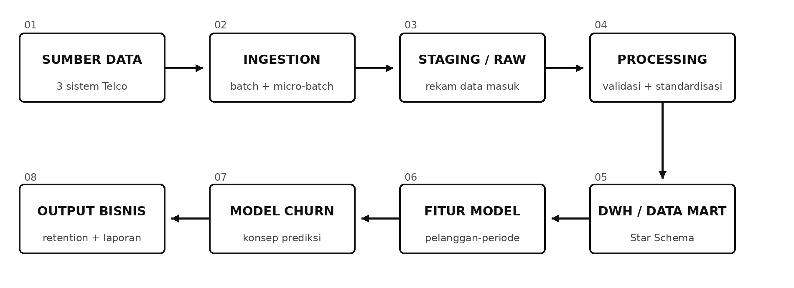

# Telco Data Engineering Pipeline — End-to-End (Synthetic Demo)

A runnable **Data Engineering portfolio project**, created as a practical extension of a Week 4 mini project. It demonstrates how data from **prepaid transactions, postpaid billing, and digital-app usage** can flow through a local **ELT pipeline** into a **SQLite Star Schema**, business reporting metrics, and an **AI-ready customer feature dataset**.

> **Scope and honesty:** 100% synthetic data. This is **not** Telkomsel production infrastructure, live telecom data, or actual real-time streaming. The 15-minute ingestion windows are **replayed within a single Python run**. No scheduler, broker, cloud deployment, or trained churn classifier is included.

## Architecture



Data sources → CSV ingestion → `raw_events` → cleaning / quarantine → conformed dimensions and facts → customer features for a future churn model; pipeline metadata and quality alerts are written to SQLite and JSON.

## Tech stack

**Python 3.10+ (standard library only)**, **SQLite / SQL**, `csv`, `sqlite3`, `unittest`. No `pip install` necessary.

## Quick start

From the repository root:

```bash
python run_pipeline.py generate --run-date 2026-10-24
python run_pipeline.py run --run-date 2026-10-24
python -m unittest discover -s tests -v
```

The first command regenerates deterministic CSV inputs with a fixed seed. The second creates `outputs/telco_dwh.sqlite`, `outputs/customer_features.csv`, and `outputs/run_report.json`. The third runs the automated test suite. On Windows, `python` may be `py`.

To verify reruns are safe, execute the `run` command again with the same inputs. `inserted_raw` should become **0** and fact-table row counts should stay the same. Run counters grow intentionally because every execution is logged. To reproduce the first-run monitoring report, remove the generated SQLite DB and JSON/CSV outputs before running once; **do not delete any real database**.

## Reproduced local result (fixed seed; 240 synthetic customers)

| Measurement | Observed | Interpretation |
|---|---:|---|
| CSV input rows | 12,138 | Includes duplicate and deliberately malformed examples |
| Unique rows in raw | 12,136 | Two duplicate business keys ignored |
| Invalid source records | 4 | Quarantined: negative usage, unknown ID, bad date, missing ID |
| Customer dimension | 240 | One row per synthetic customer |
| Prepaid fact | 1,105 | One row per successful top-up transaction |
| Postpaid fact | 84 | One row per invoice |
| App usage daily fact | 9,116 | One row per customer × day × app category |
| Customer features | 240 | 14 numeric features, 1 as-of date, and 1 synthetic ID |
| Foreign key checks | PASS | All fact references valid |
| Alerts | 1 warning | Quarantined records; pipeline still successful |
| Simulated freshness | 5 minutes | Difference between source event and *synthetic cutoff*, not live latency |

The pipeline-reported success rate is 100% after **one local successful run**; this is *not* an estimate of production reliability.

## Project structure

```text
.
├── run_pipeline.py                 # CLI entry point
├── telco_pipeline/
│   ├── generator.py                # deterministic, synthetic CSV generation
│   └── pipeline.py                 # ingestion, quality, DWH, feature preparation
├── sql/schema.sql                  # raw, dimensions, facts, quality + monitoring tables
├── data/synthetic/                # generated example input CSV files
├── outputs/sample/                # verified example outputs, including sample SQLite DB
├── docs/
│   ├── end_to_end_flow.png         # conceptual architecture (scope explained below)
│   ├── dwh_model.png               # conceptual star schema diagram
│   ├── data_dictionary.md          # tables, grain, feature meanings
│   └── runbook.md                 # failure handling and operation
├── sql/sample_queries.sql         # sample BI queries
└── tests/test_pipeline.py         # 6 unittest scenarios
```

The architecture diagrams represent a scalable **target design**, not a claim that all its systems exist in the code. Specifically, raw staging is modeled by SQLite `raw_events` rather than a cloud data lake, an application-level model is not trained, and true incremental production processing is left as an improvement.

## Operational design

- **Idempotency:** ingestion `PRIMARY KEY (source, record_key)`; fact business-key uniqueness; grouped usage facts rebuilt from raw history on rerun.
- **Validation:** customer/plan matching, nonnegative numeric values, timestamps no later than the synthetic cutoff, invoice amount consistency, foreign-key check.
- **Quarantine:** invalid raw source record IDs and reasons are recorded in `data_quality_issues`; valid records still flow.
- **Monitoring:** `pipeline_runs` table, `alerts` table, and `run_report.json`. Warning when source records are quarantined; critical alert if invalid ratio exceeds a **proposed** 1%; warning if *simulated* freshness is over **proposed** 120 minutes.
- **Reliability limits:** snapshot processing scans raw usage history on each run, meaning it is appropriate for a small reproducible demo, **not high-volume production**; production needs affected-partition incremental upserts, scheduled jobs, privacy/access control, and orchestration.

## Data and model boundary

`customer_features.csv` contains only features known at `as_of_date` (usage 7 days, previous 7 days, tenure, prepaid top-up 30 days, postpaid payment ratio, etc.). **No churn ground-truth label, training job, or predicted probability is generated**. For a supervised churn model, Data Science must supply a business-approved outcome label from a future observation window, split training/testing by time, and validate drift and metrics. Never train on the synthetic customer ID as a feature.

Top-up amount and billed amount are **not identical to recognized revenue**. They remain separate measurements.

## Disclosure / intended use

Suitable for explaining architecture, SQL modeling, data preparation, and testable operational controls in a junior Data Engineering portfolio. Not suitable for customer outreach, finance reporting, production operation, or decisions about real customers.

See [data dictionary](docs/data_dictionary.md) and [incident runbook](docs/runbook.md) for further details.
